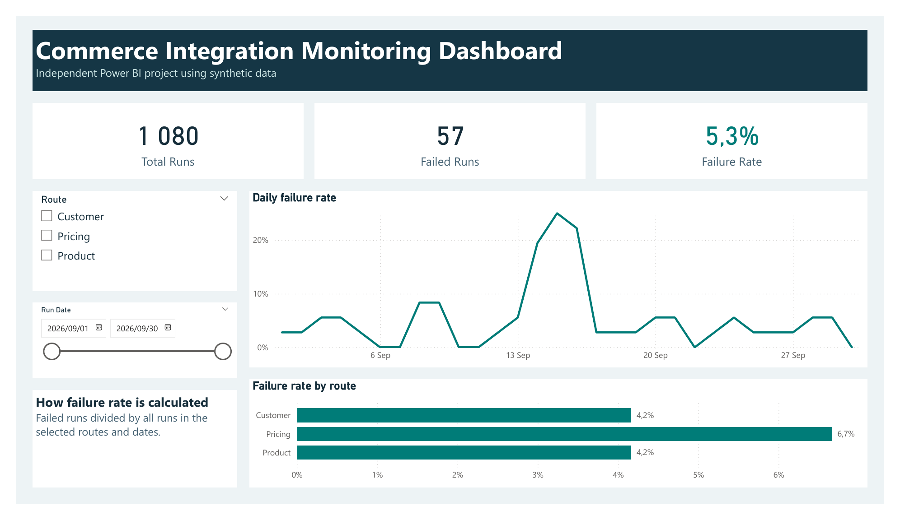

# Commerce Integration Monitoring Dashboard

**Independent Power BI project using synthetic data.**

This one-page Power BI report shows which product, pricing, and customer syncs fail most often and when failures spike. It covers September 2026 and can be filtered by route and date.

Pricing had the highest monthly failure rate at 6.7%. From September 14 to 16, 21 of 48 pricing syncs failed (43.8%). The failure rate was 2.5% across the rest of the month (11 of 432).

[Download the Power BI Desktop report](Commerce%20Integration%20Monitoring.pbix)

## How it works

Power Query reads the synthetic [run log](data/run-log.csv) and [route lookup](data/routes.csv), trims whitespace, normalizes route IDs and statuses, and parses the run date. The model relates `Routes[Route ID]` on the one side to `Run Log[Route ID]` on the many side, so a route selection filters the run log.

`Total Runs` counts attempts. `Failed Runs` counts attempts with status `Failed`. `Failure Rate` uses DAX `DIVIDE` to calculate failed runs divided by total runs within the current selection. With no runs in the selection, the rate is blank.

## Validation

The CSV has unique run IDs, valid statuses after normalization, and a matching lookup entry for every route ID. The Power BI cards matched the CSV counts for all three selections.

| Report selection | Total runs | Failed runs | Failure rate |
| --- | ---: | ---: | ---: |
| All routes, September 1–30 | 1,080 | 57 | 5.3% |
| Pricing, September 1–30 | 480 | 32 | 6.7% |
| Pricing, September 14–16 | 48 | 21 | 43.8% |

## Open or edit the report

Open the `.pbix` in Power BI Desktop to explore it. For source editing, open the [Power BI project](Commerce%20Integration%20Monitoring.pbip) with its adjacent report and model folders. Select **Home → Refresh** the first time you open the project without a local data cache.

Both versions embed copies of the CSVs in their Power Query sources so the sample refreshes without a machine-specific path. To use an edited copy of either CSV, change the corresponding source in Power Query.
